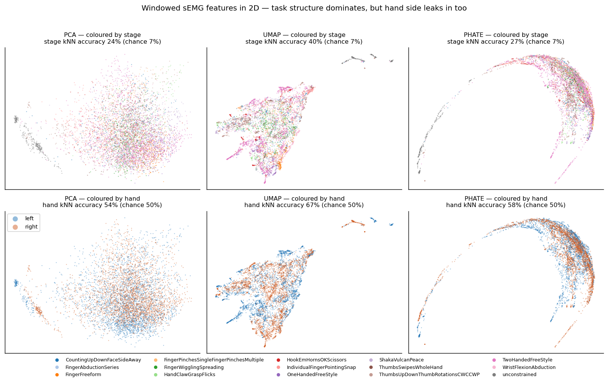

# THANOS: person, placement or drift? Muscle synergies in wrist sEMG

A student research project (NMA Impact Scholars 2026) on Meta's [emg2pose](https://github.com/facebookresearch/emg2pose) benchmark.

> **Hypothesis:** when a wristband reads your muscles, **where the band sits matters more than who you are.**
> Physical placement of the band, rather than a person's anatomy, dominates how each muscle shows up across the 16 electrodes.

## Why this matters

sEMG wristbands could read hand movement without cameras, but decoders trained on some people fail on new ones.
On emg2pose, the best model is off by **15.8°** per joint for a new person doing a new movement, barely better than
the **18.9°** you get by ignoring the EMG and always guessing the average pose.

Three things could cause this, and each needs a different fix:

| Source of variation | Where it shows up in emg2pose | Fix it would need |
|---|---|---|
| **Person** (anatomy, tissue) | Between subjects | Profile each user once |
| **Placement** (band shifts each time it's put on) | Between sessions of one subject | Recalibrate every time the band goes on |
| **Drift** (signal changes during one wearing) | Between recordings in one session | Adapt continuously |

Nobody has measured these against each other. emg2pose's nesting (193 subjects → 751 sessions → 25,253 recordings)
lets us separate them.

## Research questions

| Stage | Question | How | Data | Where |
|---|---|---|---|---|
| **Aim 1.1** | How many muscle synergies are there? | NMF, pick k by held-out VAF | mini (1 person) | [`02_how_many_synergies`](notebooks/experiments/02_how_many_synergies/02_how_many_synergies.ipynb) |
| **Aim 1.2** | Are they real, not artifacts? | Shuffle, new-movement, neighbour and two-hands tests | mini | [`03_are_synergies_real`](notebooks/experiments/03_are_synergies_real/03_are_synergies_real.ipynb) |
| **Aim 1.3** | Do they carry the pose information? | Predict pose from k synergies vs all 16 channels | mini | [`04_synergies_predict_pose`](notebooks/experiments/04_synergies_predict_pose/04_synergies_predict_pose.ipynb) |
| **Aim 1** | Are synergies **shared across people**, or individual? | Match synergies across subjects after correcting band rotation | full (193 people) | to come |
| **Aim 2** | How much of the variation is **person vs placement vs drift**? | Mixed-effects variance partition of the per-recording synergy patterns | full | to come |

We are at **Aim 1 on the mini dataset**: building and checking the synergy pipeline on one person before scaling up.
The full plan, with tasks and how each answer could prove us wrong, is in **[`PROJECT_OUTLINE.md`](PROJECT_OUTLINE.md)**.

## What we've found so far

From the [EDA](notebooks/eda/02_eda_features_embeddings.ipynb) on the mini dataset:
- **The EMG is low-dimensional:** 3 principal components capture 80% of the variance, 7 capture 90%.
- **Placement leaves a fingerprint:** which hand a recording came from (two placements on one person) is under 1% of
  the linear variance, yet a nonlinear embedding identifies it 67% of the time (54% linear, 50% chance).
  That's the first hint for the hypothesis.

**Data now:** the emg2pose *mini* split: 1 participant, 30 recordings (15 movement tasks × 2 hands), each about
1 minute, with 16 EMG channels at 2 kHz and 20 hand joint angles from motion capture. With one participant,
we can't yet make claims about people in general.

## Quick start

**On Colab:** open a notebook from this repo in Colab (File → Open notebook → GitHub → `Wilbertbh-Tan/emg2pose`)
and run the first cell. It clones the repo and downloads the mini dataset (~617 MB) by itself.

**Locally:** follow [Setup](#setup) below, then open a notebook from inside the repo. The first cell finds the
repo root and downloads the dataset if `emg2pose_dataset_mini/` is missing.

**Run notebook 01 first.** It saves `data/processed_mini.npz`, which all the other notebooks load.

## Notebooks

| # | Notebook | What it does | Owner |
|---|---|---|---|
| 01 | [`01_data_prep`](notebooks/experiments/01_data_prep/01_data_prep.ipynb) | Clean, shared data for every other notebook (run first) | Person A |
| 02 | [`02_how_many_synergies`](notebooks/experiments/02_how_many_synergies/02_how_many_synergies.ipynb) | Aim 1.1: how many synergies? | Person B |
| 03 | [`03_are_synergies_real`](notebooks/experiments/03_are_synergies_real/03_are_synergies_real.ipynb) | Aim 1.2: are they real? | Person C |
| 04 | [`04_synergies_predict_pose`](notebooks/experiments/04_synergies_predict_pose/04_synergies_predict_pose.ipynb) | Aim 1.3: do they predict hand pose? | Person D |
| 05 | [`05_results_summary`](notebooks/experiments/05_results_summary/05_results_summary.ipynb) | Final figures and answers | Everyone |
| 06 | [`06_synergy_dynamics`](notebooks/experiments/06_synergy_dynamics/06_synergy_dynamics.ipynb) | *(optional)* Q4: driven by commands? | Person A |

Notebook 01 is built. Notebooks 02–06 are starters with `# TODO` gaps to fill in. Each folder also has a
`log.md` for notes on what you expected, what happened and what you learned.

### Folder layout

| Folder | What's in it |
|---|---|
| [`notebooks/experiments/`](notebooks/experiments/) | The project notebooks above (01–06), plus [`advanced_plan/`](notebooks/experiments/advanced_plan/research_plan.md) with ideas for later |
| [`notebooks/eda/`](notebooks/eda/) | Exploratory notebooks: 00 Meta's tutorial · 01 first look at the data · 02 feature EDA and figures · 03 THANOS master pipeline |
| [`eda/`](eda/) | Helper code the EDA notebooks import (`features.py`), the figure script and saved figures |
| [`docs/`](docs/) | Slides and talk script |

## Team rules

1. **Test on data the model didn't see**, and hold out whole recordings, never random rows.
2. **Always compare with a simple baseline.** A number alone means nothing.
3. **Use the shared data from notebook 01.** No private preprocessing.
4. **One person per notebook.** Restart and "Run all" before committing; pull before you push.
5. **Write down what you expect before running.** Then compare.
6. **Never commit data** (`*.hdf5`, `*.npz`, dataset folders). `.gitignore` already blocks them.

## Earlier exploration

Windowed sEMG features embedded in 2D with PCA, UMAP and PHATE, coloured by stage (top) and by hand
(bottom). Task structure dominates, but hand side leaks in too. See [`eda/`](eda/) for the full analysis.
These 2D plots are for looking, not concluding.



---

# Original emg2pose documentation

The rest of this README is Meta's original documentation for the dataset and the baseline models.

[ `[Paper](https://arxiv.org/abs/2412.02725)` ] [ `[Dataset](https://fb-ctrl-oss.s3.amazonaws.com/emg2pose/emg2pose_dataset.tar)` ] [ `[Blog](https://ai.meta.com/blog/open-sourcing-surface-electromyography-datasets-neurips-2024/)` ] [ `[BibTeX](#citing-emg2pose)` ]

A dataset of Surface electromyography (sEMG) recordings paired with ground-truth, motion-capture recordings of the hands. Data loading, baseline model training, and baseline model evaluation code are provided.

## Data

The entire dataset has $25,253$ HDF5 files, each consisting of time-aligned, 2kHz sEMG and joint angles for a single hand in a single stage. Each stage is ~1 minute. There are $193$ participants, spanning $370$ hours and $29$ stages. `emg2pose.data.Emg2PoseSessionData` offers a programmatic read-only interface into the HDF5 session files.

The full dataset statistics are as follows:


The `metadata.csv` file includes the following information for each HDF5 file:


| Column           | Description                                                                                            |
| ---------------- | ------------------------------------------------------------------------------------------------------ |
| `user`           | Anonymized user ID                                                                                     |
| `session`        | Recording session (there are multiple stages per recording session)                                    |
| `stage`          | Name of stage                                                                                          |
| `side`           | Hand side (`left` or `right`)                                                                          |
| `moving_hand`    | Whether the hand is prompted to move during the stage                                                  |
| `held_out_user`  | Whether the user is held out from the training set                                                     |
| `held_out_stage` | Whether the stage is held out from the training set                                                    |
| `split`          | `train`, `test`, or `val`                                                                              |
| `generalization` | Type of generalization; across user (`user`), stage (`stage`), or across user and stage (`user_stage`) |


## Setup


### Environment and Dependencies

```shell
# Clone the repo, setup environment, and install local package
# Clone this fork (it has the project notebooks and eda/; upstream does not)
git clone https://github.com/Wilbertbh-Tan/emg2pose.git ~/emg2pose
cd ~/emg2pose
conda env create -f environment.yml

# Activate the environment
conda activate emg2pose

# Install the emg2pose package
pip install -e .

# Install the UmeTrack package (for forward kinematics and mesh skinning)
pip install -e emg2pose/UmeTrack
```


## Getting Started (Small, Sanity-Check Dataset)

The full dataset is $431$ GiB -- which can be cumbersome for a quick start. As a solution, we
also host a smaller (~ $600$ MiB) version of the dataset which can be downloaded and used to run
a sanity-check version of the train and eval logic.

### (Optional) Download Just the Metadata CSV (5 MiB)

The `emg2pose_metadata.csv` file described above can be downloaded on its own using the following endpoint.

NOTE: this metadata file is also included in each of the dataset downloads

```shell
# Download (just) the metadata.csv file to ~/emg2pose_metadata.csv
cd ~ && curl https://fb-ctrl-oss.s3.amazonaws.com/emg2pose/emg2pose_metadata.csv -o emg2pose_metadata.csv
```


### Download a Smaller Version of the Dataset (~600 MiB)

```shell
# Download a mini (600 MiB) version of the dataset
cd ~ && curl "https://fb-ctrl-oss.s3.amazonaws.com/emg2pose/emg2pose_dataset_mini.tar" -o emg2pose_dataset_mini.tar

# Unpack the tar to ~/emg2pose_dataset_mini
tar -xvf emg2pose_dataset_mini.tar
```


### Sanity Check Train / Eval

To run a sanity-check training workflow over the small, sanity-check version of the
dataset, please use the following command.

This runs training for the `tracking_vemg2pose` experiment for $5$ epochs as a sanity check.
It also runs evaluation on the validation and test splits -- again as a sanity check.

```shell
python -m emg2pose.train \
train=True \
eval=True \
experiment=tracking_vemg2pose \
trainer.max_epochs=5 \
data_split=mini_split \
data_location="${HOME}/emg2pose_dataset_mini"
```


## Getting Started (Full Dataset)

Above, we provided instructions for working with a smaller version of the dataset as a means
of sanity checking the main entrypoint (`train.py`). Here, we show how to get started with
the whole dataset.

### Download the Full Dataset (431 GiB)

```shell
# Download the full (431 GiB) version of the dataset, extract to ~/emg2pose_dataset
cd ~ && curl https://fb-ctrl-oss.s3.amazonaws.com/emg2pose/emg2pose_dataset.tar -o emg2pose_dataset.tar

# Unpack the tar to ~/emg2pose_dataset
tar -xvf emg2pose_dataset.tar
```


### Train on the Full Dataset

To launch an example, full training run for the `vemg2pose (tracking)` setting, use the following:

```shell
python -m emg2pose.train \
train=True \
eval=True \
experiment=tracking_vemg2pose \
data_location="${HOME}/emg2pose_dataset"
```

The `experiment` CLI option supports the following experiments (see `config/experiment` files):

- `tracking_vemg2pose`
- `regression_vemg2pose`
- `regression_neuropose`


## Downloading Pre-trained Checkpoints

We provide pre-trained checkpoints (as `.ckpt` files) for the following:

1. vemg2pose (tracking, regression settings)
2. neuropose (regression setting)

To download and unpack these checkpoints, run the following.

```shell
# Download checkpoints
cd ~ && curl "https://fb-ctrl-oss.s3.amazonaws.com/emg2pose/emg2pose_model_checkpoints.tar.gz" -o emg2pose_model_checkpoints.tar.gz

# Unpack to ~/emg2pose_model_checkpoints
tar -xvzf emg2pose_model_checkpoints.tar.gz
```


## Evaluation / Testing

To run basic evaluation for the validation / test splits, use the following:

Note that the `experiment` option to this script should match the checkpoint's experiment.

```shell
# Run train.py with train=False to isolate basic evaluation logic
python -m emg2pose.train \
train=False \
eval=True \
data_location="${HOME}/emg2pose_dataset" \
experiment=tracking_vemg2pose \
checkpoint="${HOME}/emg2pose_model_checkpoints/tracking_vemg2pose.ckpt"
```

To run analyses for different modes of generalization and to generate a `.csv` file with results, use
the following script.

Note that the `experiment` option to this script should match the checkpoint's experiment.

```shell
python -m emg2pose.test_analysis \
data_location="${HOME}/emg2pose_dataset" \
experiment=tracking_vemg2pose \
checkpoint="${HOME}/emg2pose_model_checkpoints/tracking_vemg2pose.ckpt"
```


## Notebook and Visualization

Meta's walkthrough of data loading, inference and visualization is in
[`notebooks/eda/00_getting_started.ipynb`](notebooks/eda/00_getting_started.ipynb).

## License

emg2pose is CC-BY-NC-SA-4.0 licensed, as found in the LICENSE file.

emg2pose is also licensed subject to the licenses of its code dependencies.

UmeTrack is licensed under Attribution-NonCommercial 4.0 International, as found in the emg2pose/UmeTrack/LICENSE and [GitHub](https://github.com/facebookresearch/UmeTrack/blob/main/LICENSE).

## Citing emg2pose

```
@inproceedings{salteremg2pose,
  title={emg2pose: A Large and Diverse Benchmark for Surface Electromyographic Hand Pose Estimation},
  author={Salter, Sasha and Warren, Richard and Schlager, Collin and Spurr, Adrian and Han, Shangchen and Bhasin, Rohin and Cai, Yujun and Walkington, Peter and Bolarinwa, Anuoluwapo and Wang, Robert and others},
  booktitle={The Thirty-eight Conference on Neural Information Processing Systems Datasets and Benchmarks Track}
}
```

