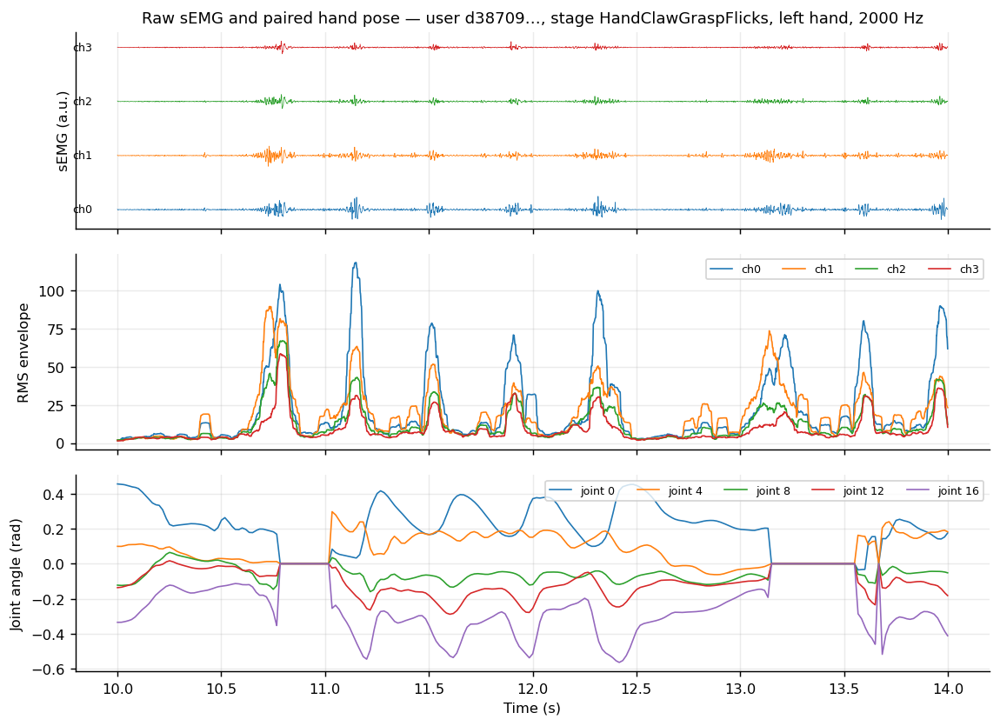
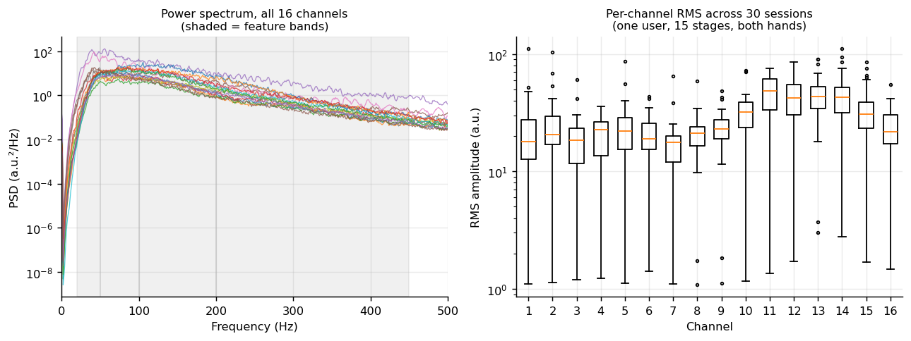
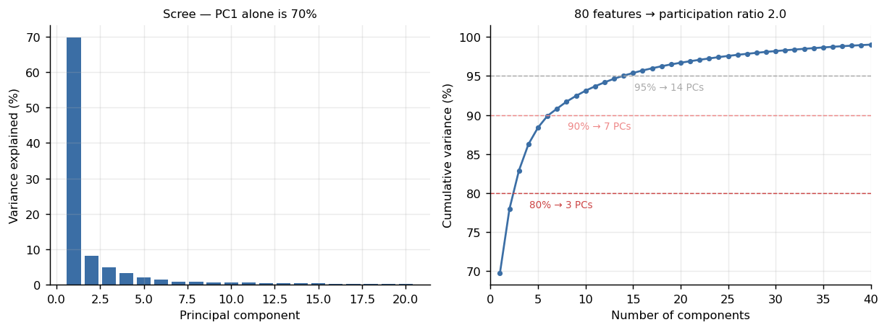
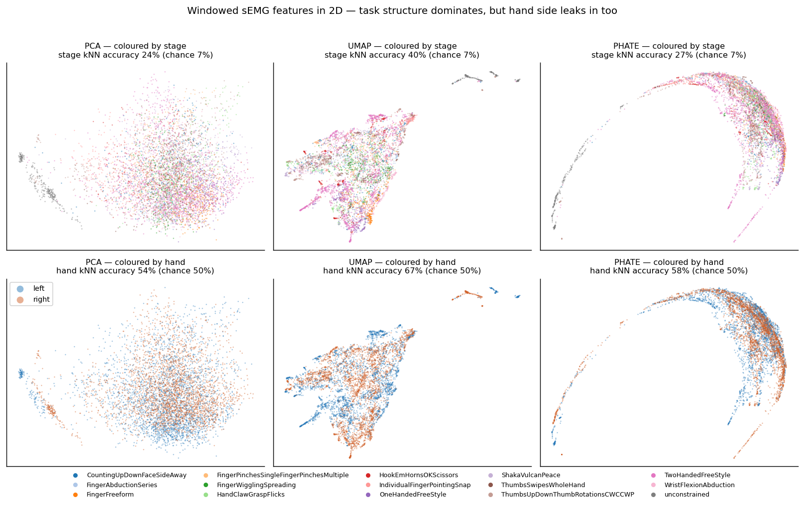

# emg2pose EDA — is manifold learning worth applying here?

Exploratory analysis of Meta's [emg2pose](https://arxiv.org/abs/2412.02725) dataset,
run to decide whether a manifold-learning approach is worth proposing.

**Short answer: yes, with one caveat.** The feature space is genuinely low-dimensional,
nonlinear methods recover task structure that PCA collapses, and the embeddings also pick
up a nuisance variable — which is precisely the problem a manifold-alignment method would
be proposed to solve.

Everything below was computed from the data; the numbers are reproducible with
`python eda/make_figures.py`.

---

## The dataset

| | |
|---|---|
| Recordings | 25,253 HDF5 files, one per hand per stage, ~1 min each |
| Participants | 193 |
| Stages | 29 distinct hand-movement tasks |
| Total | 424.2 hours |
| Signal | 16-channel surface EMG at 2 kHz |
| Target | 20 hand joint angles, time-aligned, from motion capture |

**The dataset is built around generalization.** `metadata.csv` labels every file with
`held_out_user`, `held_out_stage`, and a `generalization` column:

| split | none | stage | user | user_stage | total |
|---|---|---|---|---|---|
| train | 17,136 | 0 | 0 | 0 | 17,136 |
| val | 0 | 0 | 1,618 | 332 | 1,950 |
| test | 0 | 3,539 | 2,172 | 456 | 6,167 |

3,790 files are held out by *user* and 3,539 by *stage*. Cross-subject and
cross-condition transfer is not something we would be imposing on this dataset — it is
the axis the benchmark was designed to test.

Coverage is uneven in a way that matters for design: users contribute between 18 and 314
files (median 124), and stage coverage ranges from 104 to 193 users. The four
"freestyle"/unconstrained stages have all 193 participants; the most specific gestures
have roughly half.

---

## Method

Raw 2 kHz sEMG → windowed features (`eda/features.py`):

- 250 ms windows, 125 ms hop (50% overlap)
- per channel: log RMS amplitude + log power in 4 bands (20–50, 50–100, 100–200, 200–450 Hz)
- **16 channels × 5 features = 80 features per window**

Applied to the 30-session mini dataset this gives a **16,832 × 80** matrix. Features are
z-scored before PCA/UMAP/PHATE. Embeddings use a 6,000-window random subsample
(seed 0) for tractability.

---

## Results

### 1. Signal quality and channel structure




Power is concentrated below ~450 Hz, as expected for surface EMG, which is what the
feature bands are built around. Per-channel RMS varies by more than an order of magnitude
across the 16 channels and across sessions — channel-level amplitude is not comparable
without normalisation, the same issue that shows up in electrode-level neural recordings.

### 2. The feature space is low-dimensional



| Variance | Components needed (of 80) |
|---|---|
| 80% | **3** |
| 90% | 7 |
| 95% | 14 |
| 99% | 40 |

PC1 alone carries **69.8%**. The **participation ratio is 2.0**, meaning the effective
dimensionality of an 80-dimensional feature space is around two.

This is the core justification for the proposal: the data occupies a very small subspace
of the space it is embedded in, which is the precondition for manifold methods being
worth anything at all.

Within the first 10 PCs, **stage identity accounts for 42.1%** of total variance, while
hand side accounts for **0.9%**. The dominant structure is task, not anatomy.

### 3. Nonlinear methods recover structure PCA loses



15-nearest-neighbour classification of stage label, 5-fold CV, on the 2D embeddings
(chance = 6.7%, 15 stages):

| Representation | Stage accuracy | Hand-side accuracy (chance 50%) |
|---|---|---|
| PCA, 2D | 24.2% | 54.4% |
| **UMAP, 2D** | **40.0%** | 67.1% |
| PHATE, 2D | 26.6% | 58.5% |
| raw 80-D features | 49.6% | — |

**UMAP recovers 40% of stage labels from two dimensions** against PCA's 24%, so a
substantial part of the task structure is nonlinear and linear projection destroys it.
PHATE's trajectory-style embedding sits between the two, which is consistent with it
optimising for continuous transitions rather than cluster separation.

The honest caveat: 2D still costs accuracy against the raw 80-D features (49.6%). These
embeddings are for *structure discovery*, not as a decoding front-end — at least not at
two dimensions.

### 4. The finding that motivates the proposal

**UMAP separates left from right hand at 67% (chance 50%), even though hand side accounts
for under 1% of PCA variance.**

Hand side is a nuisance variable here. It is not the thing anyone wants to decode, but
the embedding organises around it anyway. The same thing should be expected — more
strongly — for participant identity, since inter-subject variation in electrode placement,
limb geometry and muscle recruitment is larger than left-versus-right within one person.

That is exactly the failure mode a manifold-*alignment* method addresses: find the shared
low-dimensional structure while factoring out the subject-specific component.

---

## Limitations

- **The mini dataset is a single participant** (`d387095792`, 30 sessions, 15 stages, both
  hands). The cross-user embedding — the decisive figure for this proposal — cannot be run
  on it. The S3 bucket does not permit per-file downloads, so the options are the 618 MB
  mini tar or the 431 GB full tar.
- The hand-side result is therefore a *within-subject proxy* for the cross-subject
  problem. It is suggestive, not equivalent.
- Features are hand-designed (RMS + band power). A learned front-end may show different
  dimensionality.
- Windows within a session are temporally correlated, so the kNN accuracies above are
  optimistic as absolute numbers. They are used here only to compare representations
  against each other under identical conditions.

## Proposed next step

Download the full dataset and repeat the figure-4 analysis coloured **by participant**
across the 3,790 user-held-out files. The concrete, falsifiable prediction:
**windows will cluster by participant more strongly than by stage**, and the gap between
within-subject and cross-subject decoding accuracy will scale with that clustering.

If that holds, the proposal is a manifold-alignment method — mapping each participant's
embedding into a shared space before decoding, in the spirit of Riemannian/SPD-manifold
alignment used for cross-session EEG transfer.

---

## Reproducing

```bash
pip install -r eda/requirements.txt
bash eda/download_data.sh      # metadata CSV + 618 MB mini dataset
python eda/make_figures.py     # writes eda/figures/
```

Data files are gitignored and never committed.

## Credit

Dataset and baseline code: Salter et al., *emg2pose: A Large and Diverse Benchmark for
Surface Electromyographic Hand Pose Estimation*, NeurIPS 2024 Datasets and Benchmarks.
[arXiv:2412.02725](https://arxiv.org/abs/2412.02725) ·
[facebookresearch/emg2pose](https://github.com/facebookresearch/emg2pose).
This directory adds exploratory analysis only; the dataset and loader code are the
authors' work under their respective licences.
